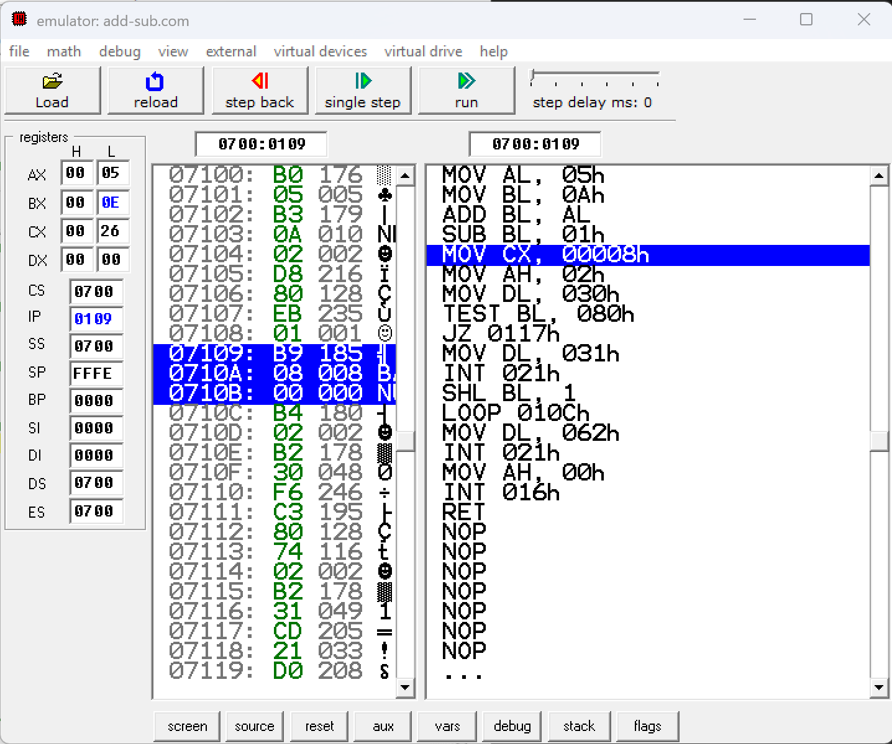
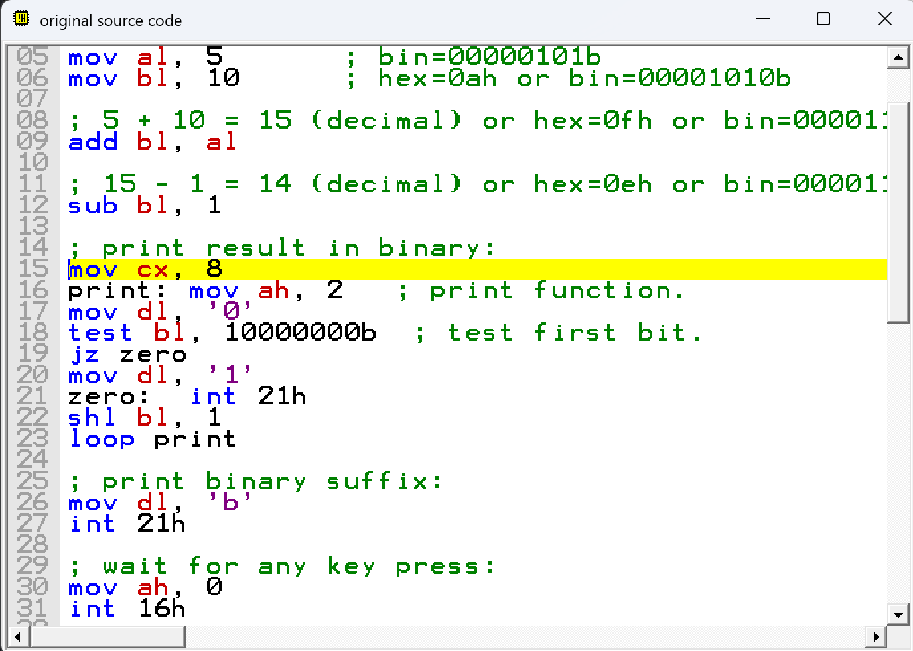
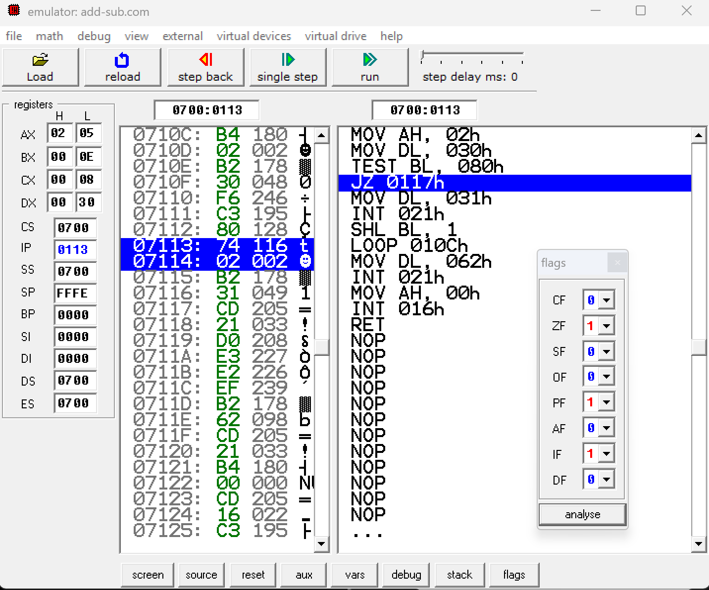
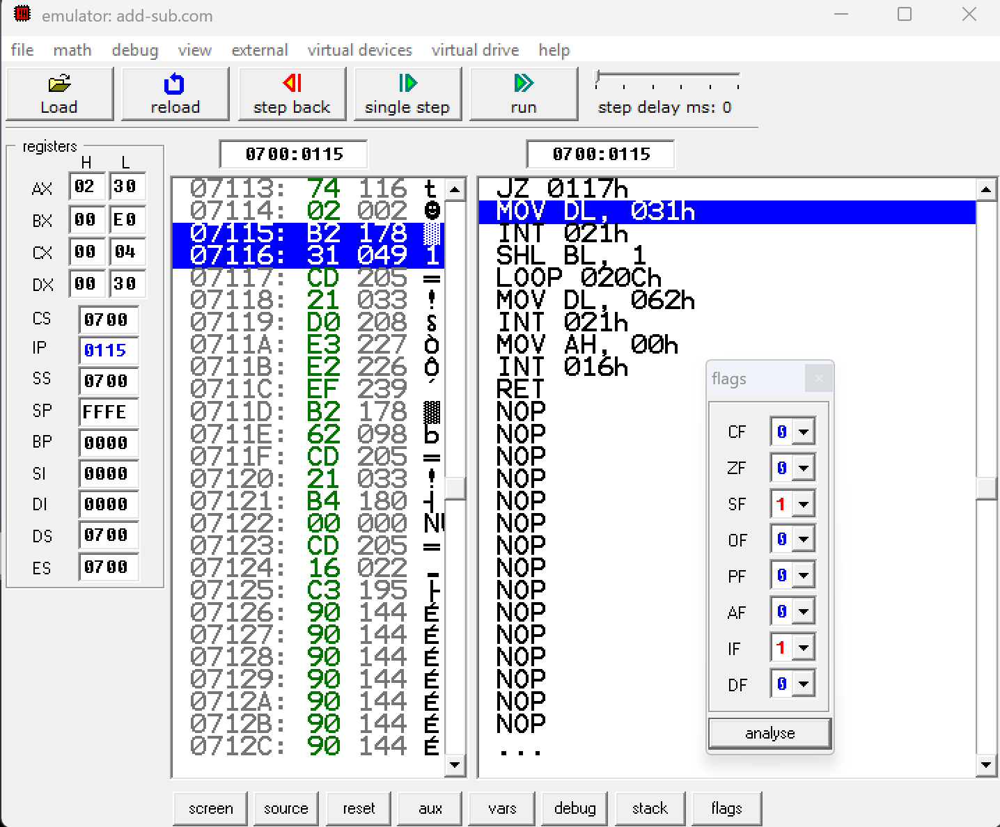
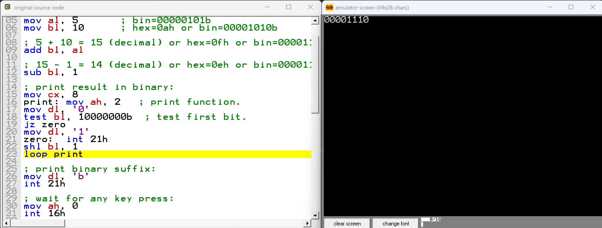
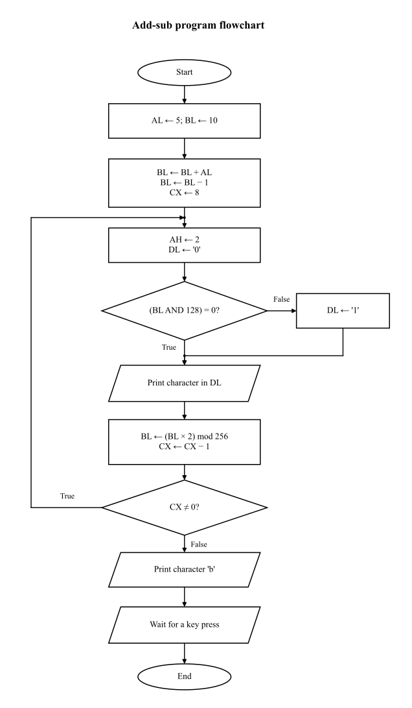

# Addition, Subtraction, and Binary Output

Exercise report for the emu8086 example [2_sample.asm](2_sample.asm).

**Student:** Phan Cong Thanh — **Student ID:** 202414796 — **Class:** 176032.

[Download the original report (Vietnamese)](Bao_cao_bai_tap_3_Phan_Cong_Thanh_202414796.pdf).

- [I. Register and flag tracking](#i-register-and-flag-tracking)
- [II. Instruction meanings and clock cycles](#ii-instruction-meanings-and-clock-cycles)
- [III. Program function](#iii-program-function)

## I. Register and flag tracking

Register values are hexadecimal (`h` suffix). Rows show the state after the instruction; loop rows show the state after `LOOP`. The initial state belongs to this emu8086 run and may differ in another environment. `CS = DS = ES = SS = 0700h`; `SI = DI = BP = 0000h` throughout the recorded source-level steps.

### I.1. Before the loop

| Instruction | AX | BX | CX | DX | SP | IP | CF | ZF | SF | OF | PF | AF | IF | DF |
| --- | --- | --- | --- | --- | --- | --- | --- | --- | --- | --- | --- | --- | --- | --- |
| Initial state | 0000h | 0000h | 0026h | 0000h | FFFEh | 0100h | 0 | 0 | 0 | 0 | 0 | 0 | 1 | 0 |
| `mov al, 5` | 0005h | 0000h | 0026h | 0000h | FFFEh | 0102h | 0 | 0 | 0 | 0 | 0 | 0 | 1 | 0 |
| `mov bl, 10` | 0005h | 000Ah | 0026h | 0000h | FFFEh | 0104h | 0 | 0 | 0 | 0 | 0 | 0 | 1 | 0 |
| `add bl, al` | 0005h | 000Fh | 0026h | 0000h | FFFEh | 0106h | 0 | 0 | 0 | 0 | 1 | 0 | 1 | 0 |
| `sub bl, 1` | 0005h | 000Eh | 0026h | 0000h | FFFEh | 0109h | 0 | 0 | 0 | 0 | 0 | 0 | 1 | 0 |
| `mov cx, 8` | 0005h | 000Eh | 0008h | 0000h | FFFEh | 010Ch | 0 | 0 | 0 | 0 | 0 | 0 | 1 | 0 |

### I.2. Inside the loop

| Iteration | AX | BX | CX | DX | SP | IP | CF | ZF | SF | OF | PF | AF | IF | DF | Bits printed so far |
| --- | --- | --- | --- | --- | --- | --- | --- | --- | --- | --- | --- | --- | --- | --- | --- |
| 1 | 0230h | 001Ch | 0007h | 0030h | FFFEh | 010Ch | 0 | 0 | 0 | 0 | 0 | 0 | 1 | 0 | `0` |
| 2 | 0230h | 0038h | 0006h | 0030h | FFFEh | 010Ch | 0 | 0 | 0 | 0 | 0 | 0 | 1 | 0 | `00` |
| 3 | 0230h | 0070h | 0005h | 0030h | FFFEh | 010Ch | 0 | 0 | 0 | 0 | 0 | 0 | 1 | 0 | `000` |
| 4 | 0230h | 00E0h | 0004h | 0030h | FFFEh | 010Ch | 0 | 0 | 1 | 1 | 0 | 0 | 1 | 0 | `0000` |
| 5 | 0231h | 00C0h | 0003h | 0031h | FFFEh | 010Ch | 1 | 0 | 1 | 0 | 1 | 0 | 1 | 0 | `00001` |
| 6 | 0231h | 0080h | 0002h | 0031h | FFFEh | 010Ch | 1 | 0 | 1 | 0 | 0 | 0 | 1 | 0 | `000011` |
| 7 | 0231h | 0000h | 0001h | 0031h | FFFEh | 010Ch | 1 | 1 | 0 | 1 | 1 | 0 | 1 | 0 | `0000111` |
| 8 | 0230h | 0000h | 0000h | 0030h | FFFEh | 011Dh | 0 | 1 | 0 | 0 | 1 | 0 | 1 | 0 | `00001110` |

The character `b` is printed after the loop; it is not part of the output shown in this table. In the original PDF, the `b` suffix in this table denotes binary notation.

### I.3. After the loop

| Instruction | AX | BX | CX | DX | SP | IP | CF | ZF | SF | OF | PF | AF | IF | DF |
| --- | --- | --- | --- | --- | --- | --- | --- | --- | --- | --- | --- | --- | --- | --- |
| `mov dl, 'b'` | 0230h | 0000h | 0000h | 0062h | FFFEh | 011Fh | 0 | 1 | 0 | 0 | 1 | 0 | 1 | 0 |
| `int 21h` | 0262h | 0000h | 0000h | 0062h | FFFEh | 0121h | 0 | 1 | 0 | 0 | 1 | 0 | 1 | 0 |
| `mov ah, 0` | 0062h | 0000h | 0000h | 0062h | FFFEh | 0123h | 0 | 1 | 0 | 0 | 1 | 0 | 1 | 0 |
| `int 16h (Enter)` | 1C0Dh | 0000h | 0000h | 0062h | FFFEh | 0125h | 0 | 1 | 0 | 0 | 1 | 0 | 1 | 0 |
| `ret` | 1C0Dh | 0000h | 0000h | 0062h | 0000h | 0000h | 0 | 1 | 0 | 0 | 1 | 0 | 1 | 0 |

`INT` rows show the state after the service returns. This run uses Enter for `INT 16h`, producing `AH = 1Ch` (scan code) and `AL = 0Dh` (ASCII). The BIOS function also accepts other keys. emu8086's output service returns the printed character in `AL`, which explains the changes to `AX`.

Flag columns: carry (`CF`), zero (`ZF`), sign (`SF`), overflow (`OF`), parity (`PF`), auxiliary carry (`AF`), interrupt enable (`IF`), and direction (`DF`). The tables reproduce the emulator display: `AF` is architecturally undefined after `TEST` and `SHL`, even though this run displays zero. The flags window used here does not expose `TF`.

## II. Instruction meanings and clock cycles

Clock counts below refer to the original Intel 8086 instruction forms in this program, using [Intel's *The 8086 Family User's Manual*, October 1979, Table 2-21, pp. 2-51–2-67](https://www.inf.pucrs.br/~calazans/undergrad/orgcomp_EC/mat_microproc/intel-8086_family_Users_Manual.pdf). They are reference timings, not measurements from the emulator. The 51 clocks for `INT` cover interrupt entry only; handler execution, return, and keyboard waiting take additional time.

### II.1. Before the loop

```asm
mov al, 5
mov bl, 10
add bl, al
sub bl, 1
```

`MOV` assigns the source value to the destination register without changing flags. The first two instructions set `AL = 5` and `BL = 10`.

`ADD` adds `AL` to `BL`, giving 15. `SUB` subtracts 1, leaving 14 in `BL`. Both arithmetic instructions update the result flags.

**Clock cycles:** `MOV AL, 5` and `MOV BL, 10`: 4 each; `ADD BL, AL`: 3; `SUB BL, 1`: 4.



*Figure 1. After SUB, BL contains 14: `0Eh` in hexadecimal and `00001110b` in binary.*



*Figure 2. The next instruction is MOV CX, 8; the arithmetic result remains in BL.*

Equivalent basic C:

```c
unsigned char al, bl;

al = 5;
bl = 10;
bl = bl + al;
bl = bl - 1;
```

### II.2. Inside the loop

```asm
mov cx, 8
print: mov ah, 2
       mov dl, '0'
       test bl, 10000000b
       jz zero
       mov dl, '1'
zero:  int 21h
       shl bl, 1
       loop print
```

`MOV CX, 8` sets the number of bits to print. `MOV AH, 2` selects the character output function of `INT 21h`. `MOV DL, '0'` sets the default character to `'0'`.

`TEST BL, 10000000b` performs an AND to check the leftmost bit without changing `BL`. If that bit is zero, `ZF = 1`; otherwise, `ZF = 0`.

`JZ zero` jumps when `ZF = 1`, keeping `DL = '0'`. Otherwise, `MOV DL, '1'` changes the character to `'1'`. At the `zero` label, `INT 21h` prints the character in `DL`.

`SHL BL, 1` shifts `BL` left by one bit, inserts zero on the right, and moves the next bit to the leftmost position. `LOOP print` decreases `CX` by 1 and jumps to `print` when `CX` is not zero. It does not change flags.

Equivalent basic C, continuing with the unsigned byte `bl` above (`printf` is declared in `<stdio.h>`):

```c
int cx;
char dl;

cx = 8;
do {
    dl = '0';
    if ((bl & 128) != 0) {
        dl = '1';
    }
    printf("%c", dl);
    bl = bl << 1;
    cx = cx - 1;
} while (cx != 0);
```

`bl & 128` checks bit 7: zero means that bit is zero, and a nonzero result means it is one. Assignment back to the unsigned byte keeps only eight bits.

**Clock cycles:** each `MOV` here: 4; `TEST BL, 10000000b`: 5; `INT 21h`: 51; `SHL BL, 1`: 2. `JZ`: 16 when taken, 4 when not taken. `LOOP`: 17 when taken, 5 when the loop ends. `JZ` is taken five times and not taken three times; `LOOP` is taken seven times and not taken once.



*Figure 3. Iteration 1, after TEST: BL = 0Eh and ZF = 1. JZ will jump to zero, so the character printed is '0'.*



*Figure 4. Iteration 5: BL = E0h and ZF = 0. JZ was not taken; MOV DL, '1' is the next instruction. DL is still 30h in this screenshot.*



*Figure 5. The final iteration has printed all eight bits, 00001110. Execution is paused before the last LOOP; the suffix 'b' has not been printed yet.*

### II.3. After the loop

```asm
mov dl, 'b'
int 21h
mov ah, 0
int 16h
ret
```

`MOV DL, 'b'` places the suffix in `DL`; `INT 21h` prints it using the character output function still selected by `AH = 2`.

`MOV AH, 0` selects BIOS keyboard input; `INT 16h` waits for a key. Press Enter in this walkthrough. `RET` ends the program in this COM execution context.

**Clock cycles:** `MOV DL, 'b'` and `MOV AH, 0`: 4 each; `INT 21h` and `INT 16h`: 51 each; near `RET`: 8.

## III. Program function

The program computes **5 + 10 - 1 = 14** and prints its eight-bit binary representation, **`00001110b`**.

For iteration `k = 0, 1, ..., 7`, the printed bit is `floor(14 / 2^(7-k)) mod 2`. After each iteration, `BL = (2 × BL) mod 256` and `CX = CX - 1`, starting with `BL = 14` and `CX = 8`.



*Ovals: start/end. Rectangles: assignments and calculations. Diamonds: conditions. Parallelograms: input/output. [PNG version](images/flowchart.png).*
