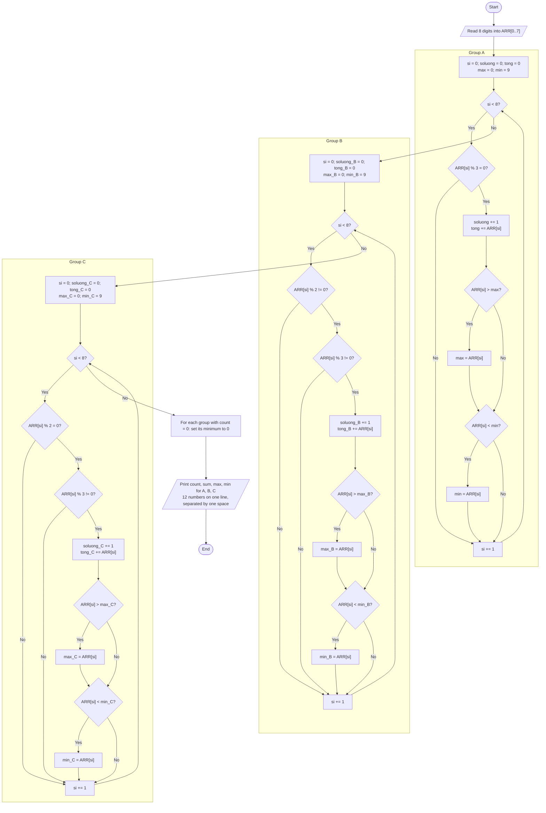

# Exercise 1: Classifying and Summarizing Eight Digits

Read eight integers from 0 to 9 into `ARR[0..7]`. Preserve the original variable names and the three separate array scans.

| Group | Condition | Possible values |
|---|---|---|
| A | Divisible by 3 | 0, 3, 6, 9 |
| B | Odd and not divisible by 3 | 1, 5, 7 |
| C | Even and not divisible by 3 | 2, 4, 8 |

For each group, print **count, sum, maximum, minimum**, in that order. Repeated values are counted and added separately; zero belongs to group A.

**Additional convention:** the assignment does not specify how to represent empty groups. This solution prints `0 0 0 0` for an empty group. The last two zeros are a convention, not mathematical extrema of an empty set.

## a. Algorithm Flowchart


[Editable Mermaid source](flowchart.mmd).

After reading eight digits, scan group A, reset `si = 0`, scan group B, reset `si = 0` again, and scan group C. For each matching element, increment the count, add to the sum, and compare the value with the current maximum and minimum. After all three scans, set the minimum of each empty group to zero and print the results.

<details>
<summary>View the Mermaid flowchart</summary>



</details>

## b. Detailed Variable Descriptions

| Name | Assembly | C | Initialization before processing | Meaning / range |
|---|---|---|---|---|
| `ARR` | `DB 8 DUP(?)` | `unsigned char ARR[8]` | Keyboard input | Eight elements, each from 0 to 9 |
| `soluong` | `DB` | `unsigned char` | 0 | Group A count, 0–8 |
| `tong` | `DB` | `unsigned char` | 0 | Group A sum, 0–72 |
| `max` | `DB` | `unsigned char` | 0 | Group A maximum |
| `min` | `DB` | `unsigned char` | 9 | Group A minimum |
| `soluong_B` | `DB` | `unsigned char` | 0 | Group B count, 0–8 |
| `tong_B` | `DB` | `unsigned char` | 0 | Group B sum, 0–56 |
| `max_B` | `DB` | `unsigned char` | 0 | Group B maximum |
| `min_B` | `DB` | `unsigned char` | 9 | Group B minimum |
| `soluong_C` | `DB` | `unsigned char` | 0 | Group C count, 0–8 |
| `tong_C` | `DB` | `unsigned char` | 0 | Group C sum, 0–64 |
| `max_C` | `DB` | `unsigned char` | 0 | Group C maximum |
| `min_C` | `DB` | `unsigned char` | 9 | Group C minimum |
| `si` / `SI` | 16-bit register | `int` | 0 at the start of each scan | Array index; accesses ARR only at indices 0–7; equals 8 when a scan finishes |
| `ch` | `AL` during input | `int` | One character per read | Character code; C uses `int` to distinguish `EOF` |

Each statistic fits in one byte because the largest possible sum is `8 × 9 = 72 < 256`. Initialize each minimum to 9 because no input exceeds 9, and each maximum to 0 because inputs are nonnegative. For an empty group, change its minimum from 9 to 0 before printing; its count, sum, and maximum are already zero.

Additional registers used by the Assembly implementation:

| Register | Purpose |
|---|---|
| `AL` | Current element; holds the quotient after `DIV BL` |
| `AH` | Cleared before byte division; holds the remainder afterward; also selects the DOS service |
| `BL` | Divisor 2 or 3 during classification, or 10 during decimal output |
| `SI` | After classification, points to the twelve contiguous result bytes |
| `CX` | Counts the twelve values to print |
| `DL` | ASCII code of the character to print |
| `SP` | Manages the stack for `CALL/RET` and `PUSH/POP` |

`print_u8` receives a value in `AL`, prints its decimal representation in the range 0–72, and preserves `AX, BX, DX`. It does not modify `SI, CX`. The twelve statistic variables are declared consecutively in the required output order, so the printing loop starts at `soluong`. If their declaration order changes, the printing loop must be updated.

## c. Assembly Program and Verification

[Complete source for EMU8086](group_a_statistics.asm).

The three scans, `check_A`, `check_B`, and `check_C`, retain the original approach. The completed version adds:

- Input checks for `'0'..'9'`; other characters are ignored, and only the first eight digits are stored.
- Non-echoing input through `INT 21h, AH=07h`, keeping typed characters out of the result row.
- Consistent output for empty groups, using the convention stated above.
- All twelve decimal results, including two-digit sums, without a trailing space.
- Program termination through `INT 21h, AX=4C00h`.

To run in EMU8086:

1. Open `group_a_statistics.asm` and select **Compile and Emulate**.
2. Select **Run** and switch to the emulator screen.
3. Type eight digits, for example `12345678`. No Enter is required; typed keys do not appear.
4. After eight digits have been read, the program prints one row and terminates.

Example input:

```text
12345678
```

Output:

```text
2 9 6 3 3 13 7 1 3 14 8 2
```

Here, A = `{3,6}`, B = `{1,5,7}`, and C = `{2,4,8}`.

## d. Corresponding C Program

[Complete C source](group_a_statistics.c).

The C version keeps `ARR`, all statistic variables, the index `si`, and the three scans in the order A → B → C. The `DIV` instruction and remainder checks in `AH` become expressions using `%`; maximum and minimum updates become `if` statements.

Compile and run, for example with GCC:

```sh
gcc -std=c11 -Wall -Wextra -Werror -pedantic group_a_statistics.c -o statistics
./statistics
```

On Windows, run `statistics.exe`. The same input produces the same result row. Digits may be entered consecutively or separated by spaces. In a line-buffered terminal, press Enter to submit the input. If EOF occurs before eight digits have been read, the C program reports an error on stderr and returns exit code 1.

## Test Results

The following results have been checked in both the C implementation and the 16-bit x86 machine code:

| Input | A: count, sum, max, min | B: count, sum, max, min | C: count, sum, max, min |
|---|---|---|---|
| `12345678` | `2 9 6 3` | `3 13 7 1` | `3 14 8 2` |
| `03699912` | `6 36 9 0` | `1 1 1 1` | `1 2 2 2` |
| `99999999` | `8 72 9 9` | `0 0 0 0` | `0 0 0 0` |
| `77777777` | `0 0 0 0` | `8 56 7 7` | `0 0 0 0` |
| `88888888` | `0 0 0 0` | `0 0 0 0` | `8 64 8 8` |
| `00000000` | `8 0 0 0` | `0 0 0 0` | `0 0 0 0` |
| `24824824` | `0 0 0 0` | `0 0 0 0` | `8 34 8 2` |

[Reproducible test](test_statistics.py): 120 input cases, including 100 random arrays with a fixed seed, each digit repeated eight times, invalid characters, separators, empty groups, and two-digit sums. Checks cover all twelve result bytes, the input array, memory write bounds, stack balance, exactly eleven spaces, and the final newline. Three additional EOF cases cover the C program.

The test compiles C with GCC and treats warnings as errors. For Assembly, it converts **memory-operand syntax** to FASM, assembles 16-bit machine code, and executes it with Unicorn while simulating the three DOS services used. The syntax conversion does not change the algorithm.

To rerun the test with GCC, FASM, and the Python `unicorn` package available:

```sh
python test_statistics.py
```

Set `FASM` and `CC` to the compiler paths if they are not on PATH. **The program has not been verified using the EMU8086 interface or compiler**; the steps in part c describe how to run it there.
