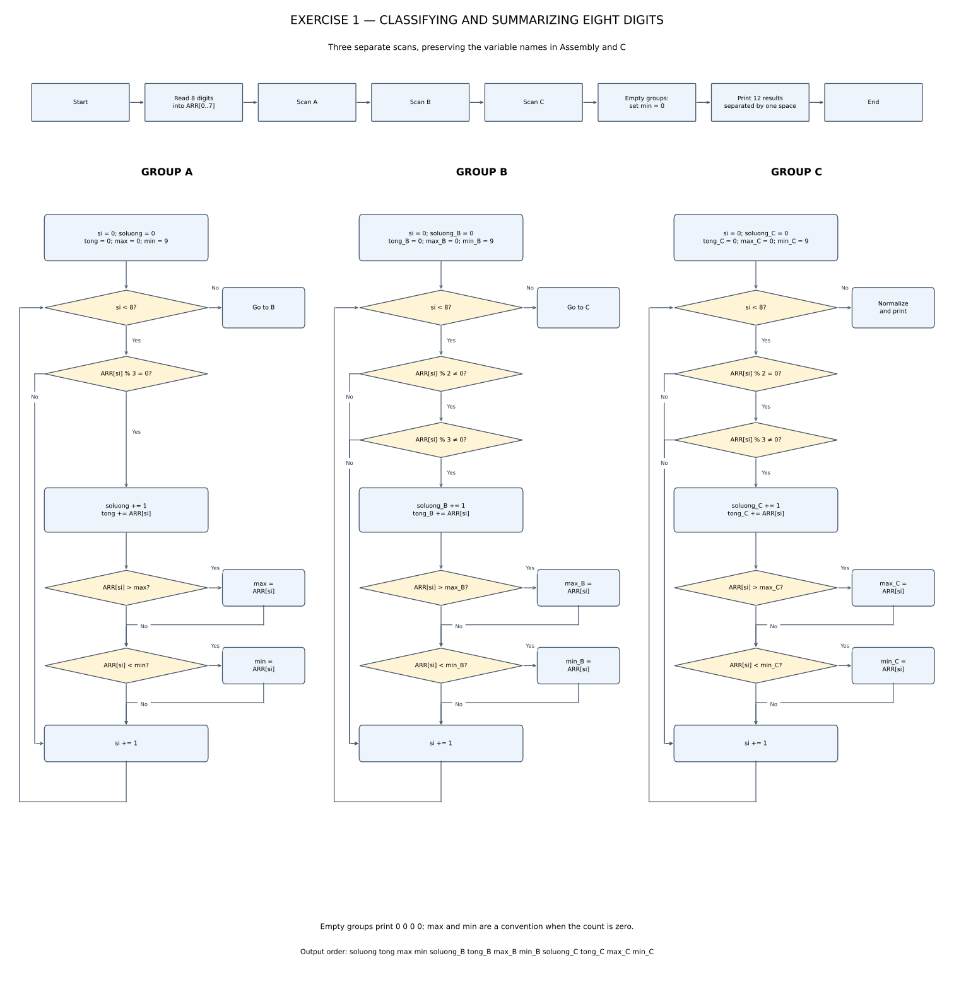
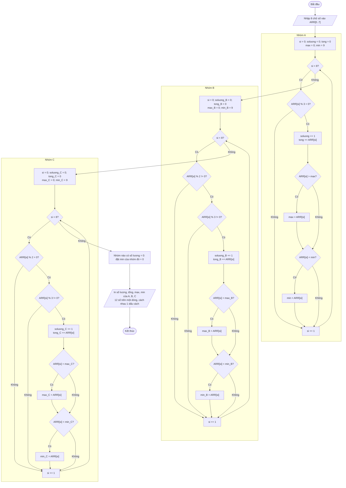

# Bài 1: Phân loại và thống kê tám chữ số

Nhập tám số nguyên từ 0 đến 9 vào `ARR[0..7]`. Giữ đúng tên biến và cấu trúc ba vòng duyệt riêng của bài làm ban đầu.

| Nhóm | Điều kiện | Giá trị có thể nhận |
|---|---|---|
| A | Chia hết cho 3 | 0, 3, 6, 9 |
| B | Lẻ và không chia hết cho 3 | 1, 5, 7 |
| C | Chẵn và không chia hết cho 3 | 2, 4, 8 |

Mỗi nhóm in lần lượt **số lượng, tổng, lớn nhất, nhỏ nhất**. Các phần tử trùng nhau vẫn được đếm và cộng riêng; số 0 thuộc nhóm A.

**Quy ước bổ sung:** đề không quy định trường hợp nhóm rỗng. Bài làm chọn in `0 0 0 0` cho nhóm đó; hai số cuối là quy ước, không phải cực trị toán học của tập rỗng.

## a. Lưu đồ thuật toán



[Nguồn lưu đồ Mermaid có thể chỉnh sửa](flowchart.mmd).

Nhập đủ tám chữ số, duyệt nhóm A, đặt lại `si = 0` rồi duyệt B, tiếp tục đặt lại `si = 0` rồi duyệt C. Mỗi lần gặp phần tử phù hợp: tăng số lượng, cộng tổng, so sánh để cập nhật max và min. Sau ba vòng, đặt min của nhóm rỗng bằng 0 và in kết quả.

<details>
<summary>Xem trực tiếp lưu đồ Mermaid</summary>



</details>

## b. Mô tả chi tiết các biến

| Tên | Assembly | C | Khởi tạo trước khi xử lý | Ý nghĩa / phạm vi |
|---|---|---|---|---|
| `ARR` | `DB 8 DUP(?)` | `unsigned char ARR[8]` | Nhập từ bàn phím | 8 phần tử, mỗi phần tử 0–9 |
| `soluong` | `DB` | `unsigned char` | 0 | Số phần tử nhóm A, 0–8 |
| `tong` | `DB` | `unsigned char` | 0 | Tổng nhóm A, 0–72 |
| `max` | `DB` | `unsigned char` | 0 | Giá trị lớn nhất nhóm A |
| `min` | `DB` | `unsigned char` | 9 | Giá trị nhỏ nhất nhóm A |
| `soluong_B` | `DB` | `unsigned char` | 0 | Số phần tử nhóm B, 0–8 |
| `tong_B` | `DB` | `unsigned char` | 0 | Tổng nhóm B, 0–56 |
| `max_B` | `DB` | `unsigned char` | 0 | Giá trị lớn nhất nhóm B |
| `min_B` | `DB` | `unsigned char` | 9 | Giá trị nhỏ nhất nhóm B |
| `soluong_C` | `DB` | `unsigned char` | 0 | Số phần tử nhóm C, 0–8 |
| `tong_C` | `DB` | `unsigned char` | 0 | Tổng nhóm C, 0–64 |
| `max_C` | `DB` | `unsigned char` | 0 | Giá trị lớn nhất nhóm C |
| `min_C` | `DB` | `unsigned char` | 9 | Giá trị nhỏ nhất nhóm C |
| `si` / `SI` | Thanh ghi 16 bit | `int` | 0 ở đầu mỗi vòng | Chỉ số mảng; chỉ truy cập ARR khi 0–7; bằng 8 khi kết thúc vòng |
| `ch` | `AL` khi nhập | `int` | Mỗi lần đọc một ký tự | Mã ký tự; C dùng `int` để phân biệt `EOF` |

Các biến thống kê chỉ cần một byte vì tổng lớn nhất là `8 × 9 = 72 < 256`. Cực tiểu khởi tạo bằng 9 vì dữ liệu không vượt quá 9; cực đại khởi tạo bằng 0 vì dữ liệu không âm. Nếu một nhóm rỗng, chương trình đổi min từ 9 thành 0 trước khi in; số lượng, tổng và max đã bằng 0.

Các thanh ghi phụ của bản Assembly:

| Thanh ghi | Vai trò |
|---|---|
| `AL` | Phần tử đang xét; sau `DIV BL` chứa thương |
| `AH` | Đặt bằng 0 trước phép chia byte; sau phép chia chứa số dư; cũng dùng chọn dịch vụ DOS |
| `BL` | Số chia 2, 3; khi in thập phân là 10 |
| `SI` | Sau thống kê, chuyển thành con trỏ duyệt 12 byte kết quả liền nhau |
| `CX` | Đếm 12 giá trị cần in |
| `DL` | Mã ASCII của ký tự cần in |
| `SP` | Quản lý ngăn xếp cho `CALL/RET`, `PUSH/POP` |

`print_u8` nhận giá trị ở `AL`, in số thập phân 0–72 và bảo toàn `AX, BX, DX`; không thay đổi `SI, CX`. Mười hai biến thống kê được khai báo liền nhau đúng thứ tự cần in, nên vòng in duyệt từ địa chỉ `soluong`; nếu đổi thứ tự khai báo thì phải sửa phần in.

## c. Chương trình Assembly và kiểm tra

[Code hoàn chỉnh cho EMU8086](group_a_statistics.asm).

Ba vòng `check_A`, `check_B`, `check_C` giữ nguyên cách làm của bạn. Những phần bổ sung:

- Kiểm tra ký tự nhập thuộc `'0'..'9'`; bỏ qua ký tự khác, chỉ lưu tám chữ số đầu tiên.
- Dùng `INT 21h, AH=07h` để nhập không hiện ký tự, tránh trộn dữ liệu nhập vào dòng kết quả.
- Thống nhất kết quả nhóm rỗng như quy ước ở đầu bài.
- In đủ 12 số, hỗ trợ tổng có hai chữ số, không có dấu cách cuối dòng.
- Thoát bằng `INT 21h, AX=4C00h`.

Cách chạy trong EMU8086:

1. Mở `group_a_statistics.asm`, chọn **Compile and Emulate**.
2. Chọn **Run**, chuyển vào cửa sổ màn hình giả lập.
3. Gõ tám chữ số, ví dụ `12345678`. Không cần Enter; các phím vừa gõ không hiện lên.
4. Khi nhập đủ, chương trình in một dòng và kết thúc.

Ví dụ đầu vào:

```text
12345678
```

Kết quả:

```text
2 9 6 3 3 13 7 1 3 14 8 2
```

Giải thích: A = `{3,6}`, B = `{1,5,7}`, C = `{2,4,8}`.

## d. Chương trình C tương ứng

[Code C hoàn chỉnh](group_a_statistics.c).

Giữ nguyên `ARR`, các biến thống kê, chỉ số `si` và thứ tự ba vòng duyệt A → B → C. Phép `DIV`/kiểm tra `AH` được biểu diễn bằng toán tử `%`; các nhánh cập nhật max/min được biểu diễn bằng `if`.

Biên dịch và chạy, ví dụ với GCC:

```sh
gcc -std=c11 -Wall -Wextra -Werror -pedantic group_a_statistics.c -o statistics
./statistics
```

Trên Windows chạy `statistics.exe`. Nhập cùng dữ liệu sẽ nhận cùng dòng kết quả. Có thể nhập liền tám chữ số hoặc có dấu cách; khi dùng terminal ở chế độ nhập dòng, nhấn Enter để gửi dữ liệu. Nếu hết đầu vào trước tám chữ số, bản C báo lỗi qua stderr và trả mã 1.

## Kết quả kiểm thử

Bảng dưới là các kết quả đã được kiểm tra ở cả bản C và mã máy x86 16 bit:

| Đầu vào | A: số lượng, tổng, max, min | B: số lượng, tổng, max, min | C: số lượng, tổng, max, min |
|---|---|---|---|
| `12345678` | `2 9 6 3` | `3 13 7 1` | `3 14 8 2` |
| `03699912` | `6 36 9 0` | `1 1 1 1` | `1 2 2 2` |
| `99999999` | `8 72 9 9` | `0 0 0 0` | `0 0 0 0` |
| `77777777` | `0 0 0 0` | `8 56 7 7` | `0 0 0 0` |
| `88888888` | `0 0 0 0` | `0 0 0 0` | `8 64 8 8` |
| `00000000` | `8 0 0 0` | `0 0 0 0` | `0 0 0 0` |
| `24824824` | `0 0 0 0` | `0 0 0 0` | `8 34 8 2` |

[Test có thể chạy lại](test_statistics.py): 120 bộ dữ liệu, gồm 100 bộ ngẫu nhiên có seed cố định, mọi chữ số lặp tám lần, phím không hợp lệ, dấu phân cách, nhóm rỗng và tổng hai chữ số. Kiểm tra cả 12 byte kết quả, mảng đầu vào, giới hạn ghi bộ nhớ, cân bằng ngăn xếp, đúng 11 dấu cách và xuống dòng cuối. Thêm ba trường hợp EOF cho C.

Test biên dịch C bằng GCC với cảnh báo là lỗi; bản Assembly được chuyển **cú pháp toán hạng bộ nhớ** sang FASM rồi biên dịch thành mã máy 16 bit và chạy bằng Unicorn, mô phỏng ba dịch vụ DOS được dùng. Không thay đổi thuật toán khi chuyển cú pháp.

Chạy lại test sau khi có GCC, FASM và gói Python `unicorn`:

```sh
python test_statistics.py
```

Có thể đặt `FASM` và `CC` thành đường dẫn trình biên dịch nếu chúng chưa có trong PATH. **Chưa kiểm chứng bằng giao diện hoặc trình biên dịch của EMU8086**; phần hướng dẫn ở câu c là thao tác để chạy lại tại đó.
